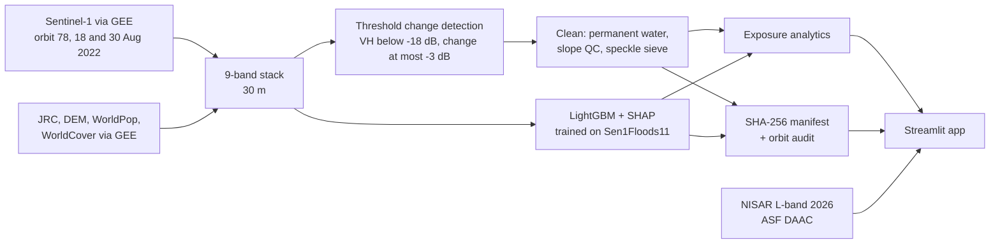
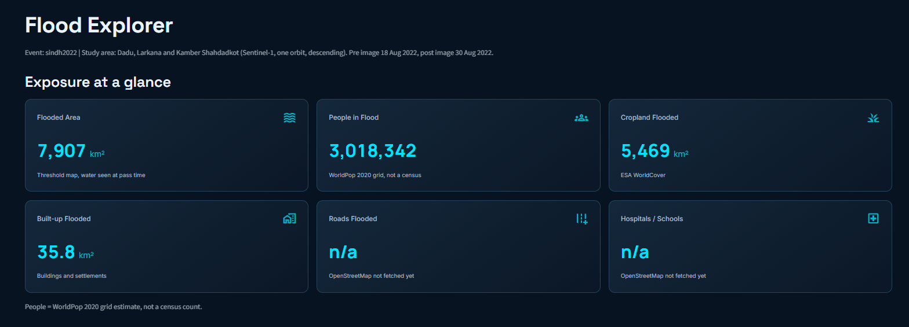
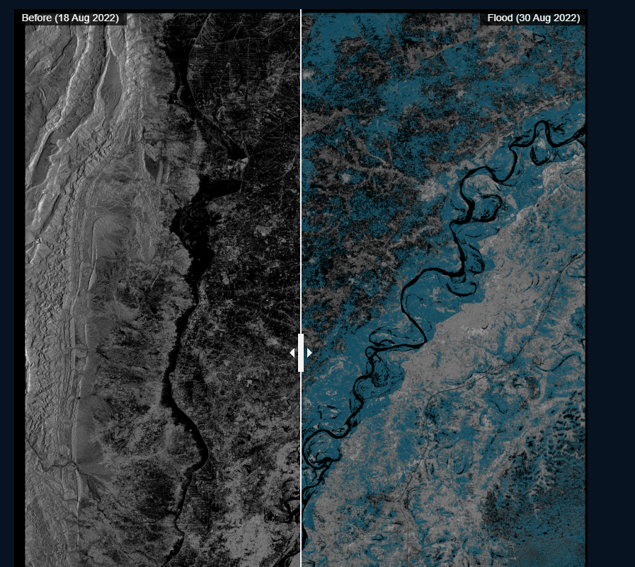
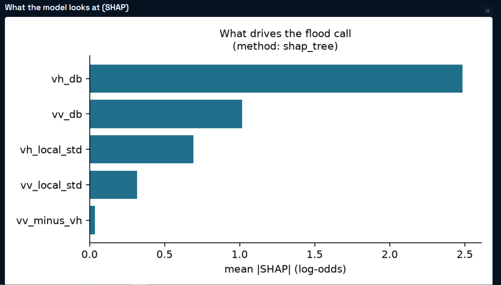
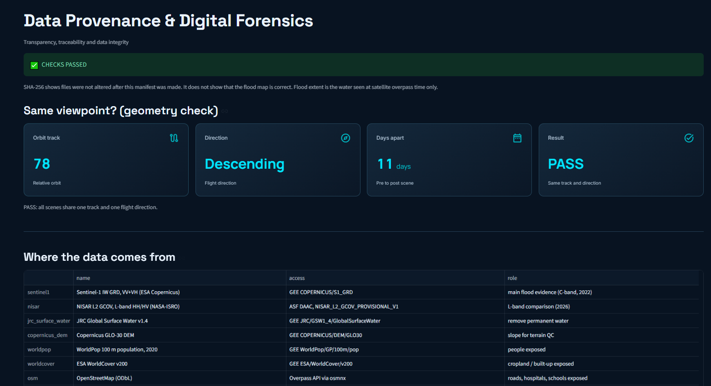

<div align="center">

# FloodLens

**Radar flood mapping for the 2022 Sindh floods that people can act on, explain and check.**

Sentinel-1 (C-band) + NISAR (L-band) · Exposure analytics · LightGBM + SHAP · SHA-256 provenance

NASA Space Apps Challenge 2026 · *Dancing with the SARs*

`Python` `Streamlit` `Sentinel-1` `NISAR` `LightGBM` `SHAP` `Google Earth Engine`

</div>

---

## 1. The problem

After a flood, relief teams need to know **where the water went, and who and what it reached**.
Clouds and night hide floods from normal satellite photos. Radar (SAR) sees through both, but raw radar data is hard to use.

Research already shows that radar can map floods. The gap we address is different:

1. A flood map alone does not say **what it means for people and crops**.
2. A reader cannot easily tell **whether to trust the result**.

## 2. Our solution

FloodLens turns radar into a flood map, then into numbers, then adds a trust layer.

| Step | What we do | Where |
|---|---|---|
| Map | Flood map of Upper Sindh 2022 (Dadu, Larkana, Kamber Shahdadkot) from Sentinel-1, one orbit, before vs. during flood | `pipeline/baseline_otsu.py` |
| Extend | NISAR L-band 2026 window over Dadu, shown next to Sentinel-1 | `pipeline/nisar_extract.py` |
| Quantify | People, cropland, built-up area, roads, health and school facilities in the flooded area | `pipeline/exposure.py` |
| Explain | LightGBM flood classifier with SHAP (global and per-pixel what-if) | `pipeline/ml.py`, `explain.py` |
| Check | SHA-256 manifest, same-orbit audit, tamper demo | `pipeline/forensics.py` |
| Show | Streamlit app with map, before/after swipe and audit pages | `frontend/` |

**What is different.** We do not claim to be the first to map this flood. Our contribution is making the result *decision-ready, explainable and checkable*. Every input and output is hashed, the ML model is tested only on an event it never saw, and the app states its limits on every page.

## 3. Data and how we use it

| Data | Source | How we use it | Why |
|---|---|---|---|
| **Sentinel-1 GRD** (VV, VH), relative orbit 78, descending, 18 Aug and 30 Aug 2022 | Google Earth Engine `COPERNICUS/S1_GRD` | Median of 3 frames per date, change detection | Same orbit and direction on both dates removes viewing-angle differences. |
| **NISAR L2 GCOV** (HH, HV), track 92, 20 Jun and 31 Aug 2026, **provisional** (CRID P05023) | NASA ASF DAAC | 30 km window over Dadu, streamed from ASF, change maps and RGB | L-band (about 24 cm) goes deeper through vegetation than C-band. NISAR launched in 2025, so it did **not** see the 2022 flood. |
| **JRC Global Surface Water** | Google Earth Engine | Removes permanent water (rivers, lakes) from the flood mask | A river is not a flood. |
| **Copernicus GLO-30 DEM** | Google Earth Engine | Slope QC (5 degrees) for radar shadow | Steep terrain looks dark like water. |
| **WorldPop 2020** (100 m) | Google Earth Engine | People inside flooded pixels | A grid estimate, not a census count. |
| **ESA WorldCover v200** | Google Earth Engine | Cropland and built-up area flooded | Turns area into impact. |
| **OpenStreetMap** | Overpass via osmnx | Roads, hospitals, schools flooded (optional step, `--osm-fetch`) | Critical infrastructure. |
| **Sen1Floods11** (446 hand-labelled chips, 11 events) | Public GCS bucket | Train and test the ML model | The only labelled flood data in the pipeline. |

All Sentinel-1 layers are stacked into a 9-band GeoTIFF at 30 m (EPSG:32642): `vv_pre, vh_pre, vv_post, vh_post, slope_deg, jrc_occurrence, pop_count, pop_cell_m2, worldcover`.

## 4. Method



**Threshold map (main result).** A pixel is flood if post-flood VH is below -18 dB and VH dropped by at least 3 dB versus the pre-flood image. Permanent water and steep slopes are removed, and speckle is sieved.

**ML map (upper bound).** LightGBM uses five post-flood features only (`vv_db, vh_db, vv_minus_vh, vh_local_std, vv_local_std`), so it transfers to events with no pre-flood image. It is evaluated by leave-one-event-out, holding out **Pakistan 2017**.

**Why both?** The threshold map is the main result. The ML map is an *upper bound*. The area where both agree is the *cautious estimate*.

**Why SHAP?** To show *why* a pixel is called flood (VH backscatter dominates), so a reader can judge whether the model is looking at sensible physics.

**Why forensics?** A map is only useful if its inputs can be traced. SHA-256 shows files were not altered after the manifest was made.

## 5. Results (Sindh 2022, from `outputs/sindh2022/summary.json`)

| Result | Value |
|---|---|
| Flooded area, threshold map (main) | **7,907 km²** |
| Flooded area, ML map (upper bound) | 14,473 km² |
| Flooded area, both agree (cautious) | 7,477 km² |
| People inside flooded pixels (WorldPop 2020) | **3,018,342** of 9,769,978 in the study area |
| Cropland flooded | 5,469 km² |
| Built-up area flooded | 35.8 km² |
| ML vs. threshold agreement | IoU 0.50 (agreement, not accuracy) |
| Forensic status | `CHECKS_PASSED` |

**Held-out test (Pakistan 2017, Sen1Floods11)**

| | Precision | Recall | F1 | IoU |
|---|---|---|---|---|
| ML (LightGBM) | 0.173 | 0.673 | 0.275 | 0.159 |
| Threshold (VH < -18 dB) | 0.121 | 0.770 | 0.209 | 0.117 |

Both methods over-call water on dry, sandy ground (low precision). We report this openly.

**Sanity check, not validation.** The official PDMA 2022 report lists 849,380 people affected in Dadu and 1,217,428 in Larkana. Our 3.0 million (three districts, people in flooded pixels) is the same order of magnitude. These numbers measure different things.

## 6. The app

Eight pages: Home, Mission Brief, Flood Explorer, NISAR Dadu 2026, Compare Imagery, Context Benchmarks, Model Explainability, Forensic Audit, About.

<!-- Add screenshots to docs/img/ and keep these lines -->
<p align="center">
  
  
  
  
</p>

## 7. Run it

```bash
git clone https://github.com/<your-user>/<repo>.git
cd <repo>
python -m venv .venv && source .venv/bin/activate     # Windows: .venv\Scripts\activate
pip install -r requirements.txt
streamlit run frontend/Home.py
```

The app reads the committed results in `outputs/` and the trained model in `ml/`, so it runs without downloading any satellite data.

### Re-run the full pipeline

```bash
python -m pytest -q tests
# 1. Google Earth Engine: run gee/export_stack.js, put the two Drive files in data/gee/
# 2. Labelled data and model
python pipeline/download_sen1floods11_http.py --out data/sen1floods11
python pipeline/train_model.py --root data/sen1floods11 --holdout Pakistan --out ml/flood_lgbm.joblib
# 3. NISAR (needs a free NASA Earthdata token in the EARTHDATA_TOKEN environment variable)
python pipeline/nisar_extract.py ...
# 4. Everything together
python pipeline/run_pipeline.py --stack data/gee/sindh2022_stack.tif --scenes data/gee/sindh2022_scenes.csv \
    --nisar-summary data/nisar_aoi/nisar_dadu_summary.json --nisar-dir data/nisar_aoi \
    --model ml/flood_lgbm.joblib
```

## 8. Repository layout

```
gee/        export_stack.js        Google Earth Engine -> 9-band stack + scene table
pipeline/   the backend (offline Python)
            nisar_extract.py       NISAR AOI cut, change maps, RGB, hashes
            preprocess.py          dB, speckle, slope, PNG helpers
            baseline_otsu.py       threshold change detection + cleaning funnel
            ml.py, train_model.py  LightGBM, leave-one-event-out
            explain.py             SHAP (global + per pixel)
            exposure.py            people, land cover, roads, facilities
            forensics.py           hashes, orbit audit, tamper test, manifest
            services.py            the only module the frontend imports
            run_pipeline.py        stack -> outputs/<event>/
ml/         trained model + held-out report
frontend/   Streamlit app
outputs/    results the app reads
tests/      python -m pytest -q tests
```

## 9. Honest limitations

- Maps water **seen at satellite pass time**. It is not a forecast and not a peak-flood extent.
- **No ground truth for Sindh 2022.** We never claim accuracy for it. ML metrics come only from the held-out Pakistan 2017 event.
- The flood area is likely **over-estimated**: dry sandy ground is dark in radar, and the pre-flood image (18 Aug) may already contain some water.
- The ML model has low precision on the held-out event, so the ML map is an upper bound.
- NISAR data is **provisional** (CRID P05023). The 2026 monsoon was minor, so NISAR shows surface change over Dadu, not a flood.
- Roads, hospitals and schools need the optional OpenStreetMap step and may show "n/a".
- `CHECKS_PASSED` means hashes were recorded and orbit geometry matches. It does **not** mean the map is correct.
- People counts are WorldPop grid estimates, not census counts.
- SHAP importance is computed on a 5,000-pixel sample.

## 10. Benchmarks and references

- Chapman et al. (2015). *Mapping Regional Inundation with Spaceborne L-Band SAR.* Remote Sensing. doi:10.3390/rs70505440
- NASA SVS 5661. NISAR view of a flood in Mozambique.
- Upper Sindh 2022 floods with Sentinel-1. Ecological Questions (2026). doi:10.12775/EQ.2026.027
- Bonafilia et al. (2020). *Sen1Floods11.* CVPR Workshops.
- PDMA Sindh 2022 flood report (sanity check only).

## 11. Team

| | Role |
|---|---|
| Abeeha | Frontend development and visualization |
| Urooj | SAR processing and digital forensics |
| Amna | Machine learning and flood detection |

## Credits

Sentinel-1 (ESA/Copernicus), NISAR (NASA-ISRO, ASF DAAC), JRC Global Surface Water, Copernicus GLO-30, WorldPop, ESA WorldCover, OpenStreetMap contributors (ODbL), Sen1Floods11.